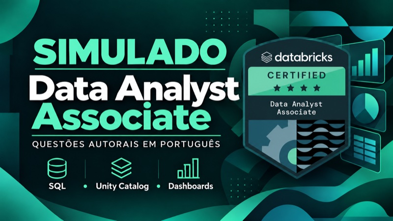

  

  
  
  
  

  Crio cursos e simulados para quem quer crescer na área de dados. 
  No YouTube, compartilho dicas, novidades e experiências de engenharia de dados.

<h2 align="center">Cursos e simulados em português</h2>

  
  

  
  

<h2 align="center">Practice tests in English</h2>

  
  
  

